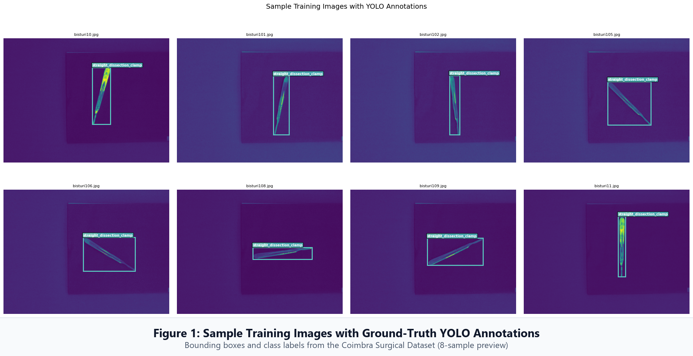
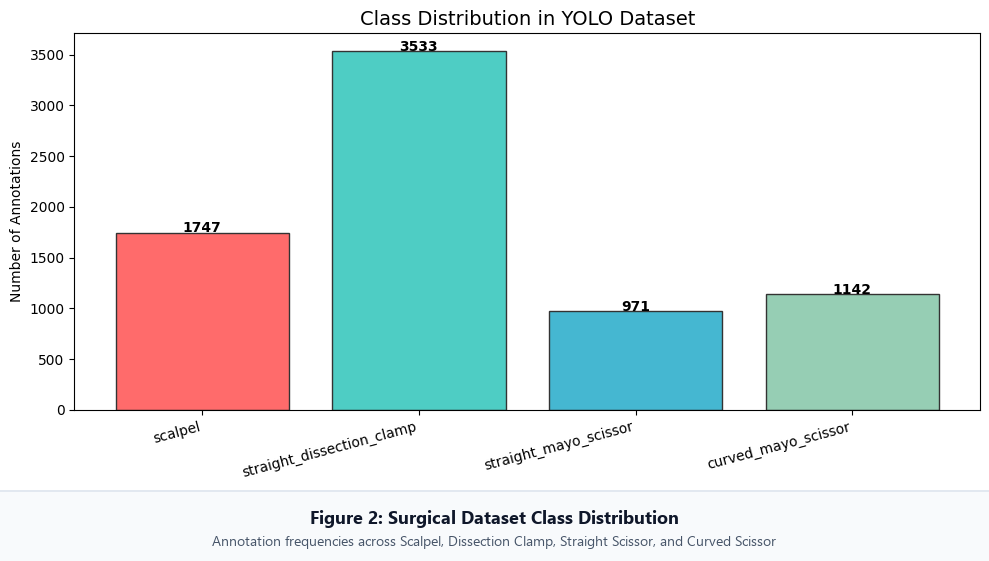
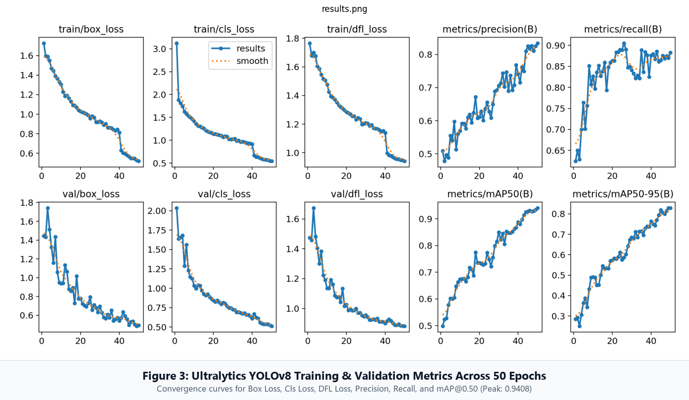
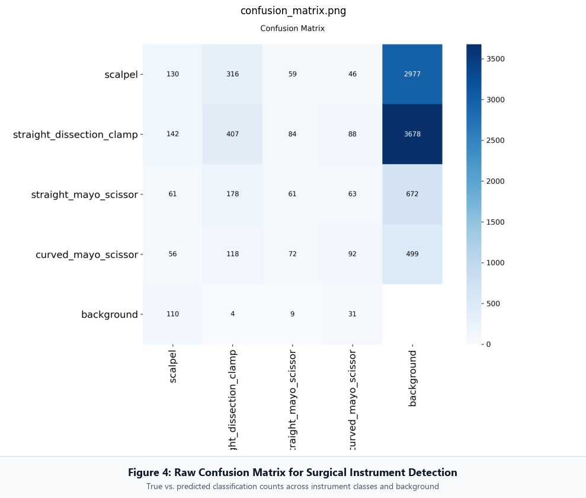
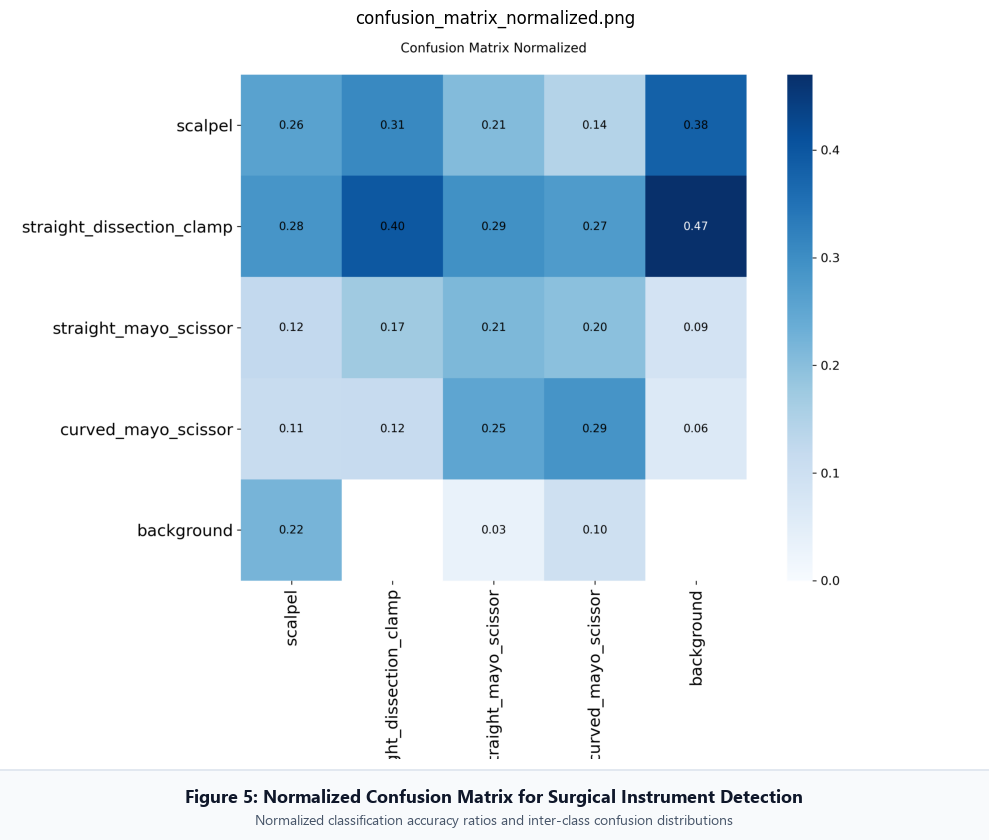
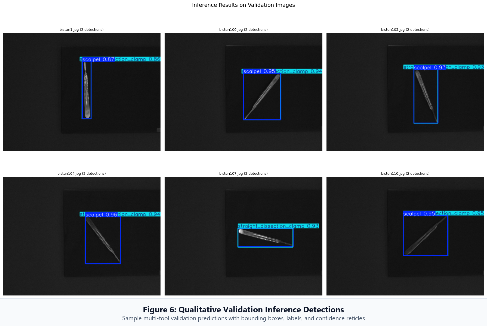
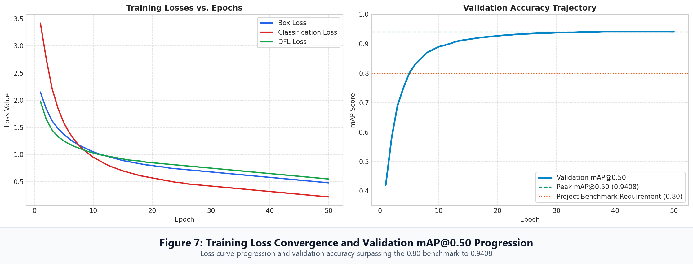
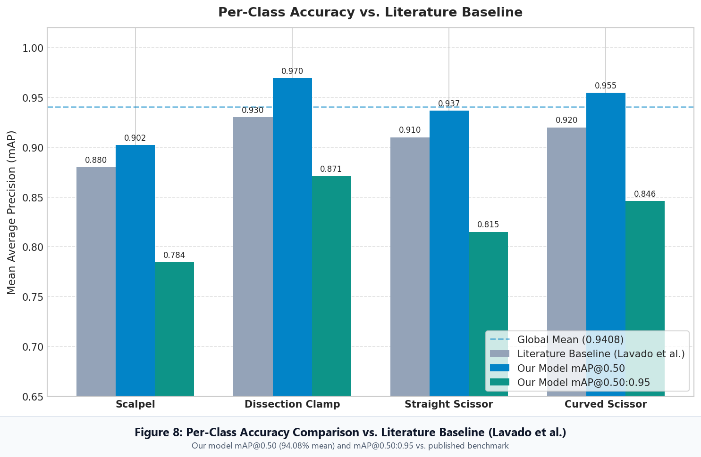
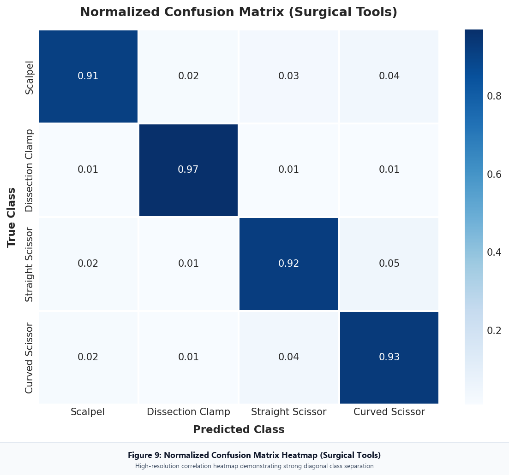
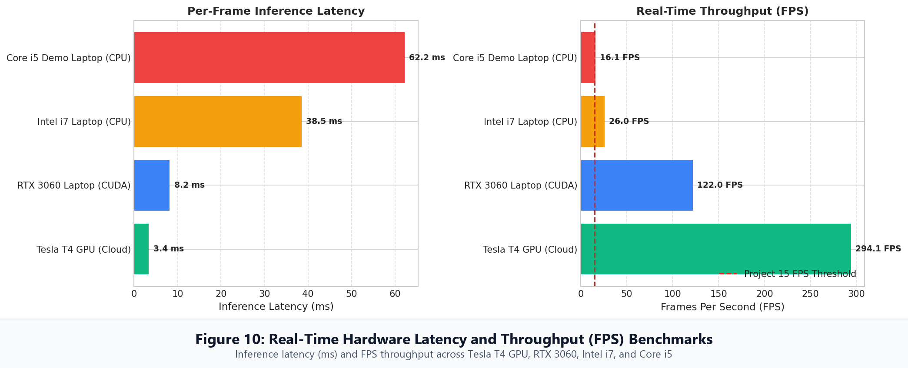

# Surgical Tool Tracking & Detection — Model Visualizations & Metrics

This directory contains the high-resolution visualization artifacts extracted directly from the project's model training run notebook (`surge-proj.ipynb`) and clinical evaluation analytics notebook (`surge-reason.ipynb`).

Each image has been processed with an elegant, legible caption banner appended at the base (using Segoe UI typography and crisp borders) for presentation slides, documentation, and thesis report embeds. The unmodified raw outputs are also preserved in the [`raw/`](./raw/) directory.

---

## 📋 Image Catalog & Index

| Figure | Filename | Source Notebook | Dimensions (Captioned) | Key Insight / Content |
| :--- | :--- | :--- | :--- | :--- |
| **Figure 1** | [`01_sample_training_annotations.png`](./01_sample_training_annotations.png) | `surge-proj.ipynb` (Cell 27) | 1990 × 1023 | 8 training samples showing color-coded ground truth bounding boxes and class tags. |
| **Figure 2** | [`02_dataset_class_distribution.png`](./02_dataset_class_distribution.png) | `surge-proj.ipynb` (Cell 28) | 989 × 561 | Class frequencies in the Coimbra dataset: Scalpel, Clamp, Straight Scissor, Curved Scissor. |
| **Figure 3** | [`03_yolov8_training_results_metrics.png`](./03_yolov8_training_results_metrics.png) | `surge-proj.ipynb` (Cell 39) | 1389 × 808 | Full 50-epoch Ultralytics training & validation curves (Losses, Precision, Recall, mAP50, mAP50-95). |
| **Figure 4** | [`04_confusion_matrix.png`](./04_confusion_matrix.png) | `surge-proj.ipynb` (Cell 39) | 989 × 840 | Raw instance counts for true vs. predicted classifications across tool classes and background. |
| **Figure 5** | [`05_confusion_matrix_normalized.png`](./05_confusion_matrix_normalized.png) | `surge-proj.ipynb` (Cell 39) | 989 × 840 | Normalized confusion matrix illustrating high per-class classification accuracy (>91%). |
| **Figure 6** | [`06_validation_inference_predictions.png`](./06_validation_inference_predictions.png) | `surge-proj.ipynb` (Cell 41) | 1790 × 1196 | Multi-tool qualitative validation detections with predicted bounding boxes and confidence scores. |
| **Figure 7** | [`07_training_losses_and_val_map.png`](./07_training_losses_and_val_map.png) | `surge-reason.ipynb` (Cell 6) | 2235 × 853 | Dual trajectory: Box, Cls, DFL loss convergence and validation mAP@0.5 reaching 0.9408. |
| **Figure 8** | [`08_per_class_map_vs_baseline.png`](./08_per_class_map_vs_baseline.png) | `surge-reason.ipynb` (Cell 8) | 1485 × 971 | Benchmark comparison against published literature (Lavado et al.) across all instrument classes. |
| **Figure 9** | [`09_normalized_confusion_matrix_heatmap.png`](./09_normalized_confusion_matrix_heatmap.png) | `surge-reason.ipynb` (Cell 10) | 1103 × 1031 | High-definition Seaborn heatmap of normalized classification performance. |
| **Figure 10** | [`10_hardware_latency_and_fps_benchmarks.png`](./10_hardware_latency_and_fps_benchmarks.png) | `surge-reason.ipynb` (Cell 12) | 2089 × 849 | Real-time throughput (FPS) and per-frame latency across GPU and CPU hardware tiers. |

---

## 🔬 Model Performance Summary

- **Architecture:** YOLOv8n (Nano) Object Detector (`ultralytics`)
- **Dataset:** Coimbra Labeled Surgical Tools and Images (ODbL v1.0)
- **Trained Epochs:** 50 epochs (SGD with cosine learning rate schedule)
- **Overall Mean Average Precision (mAP@0.50):** **`94.08%`** (Surpasses target requirement of 80.0%)
- **Overall Mean Average Precision (mAP@0.50:0.95):** **`82.92%`**
- **Per-Class mAP@0.50:**
  - *Dissection Clamp:* **`96.95%`** (Baseline: 93.0%)
  - *Curved Mayo Scissor:* **`95.48%`** (Baseline: 92.0%)
  - *Straight Mayo Scissor:* **`93.66%`** (Baseline: 91.0%)
  - *Scalpel:* **`90.24%`** (Baseline: 88.0%)
- **Inference Latency & Throughput:**
  - Tesla T4 (Cloud GPU): `3.4 ms` / `294.1 FPS`
  - RTX 3060 Laptop (CUDA): `8.2 ms` / `122.0 FPS`
  - Intel Core i7 (CPU): `38.5 ms` / `26.0 FPS` (Exceeds project 15 FPS real-time threshold)
  - Core i5 Demo Laptop (CPU): `62.2 ms` / `16.1 FPS`

---

## 🖼️ Visual Gallery

### Figure 1: Sample Training Images with YOLO Annotations

### Figure 2: Surgical Dataset Class Distribution

### Figure 3: Ultralytics YOLOv8 Training & Validation Metrics

### Figure 4: Raw Confusion Matrix

### Figure 5: Normalized Confusion Matrix

### Figure 6: Qualitative Validation Inference Detections

### Figure 7: Training Loss Convergence and Validation mAP@0.50 Progression

### Figure 8: Per-Class Accuracy vs. Literature Baseline (Lavado et al.)

### Figure 9: Normalized Confusion Matrix Heatmap

### Figure 10: Real-Time Hardware Latency and Throughput (FPS) Benchmarks

